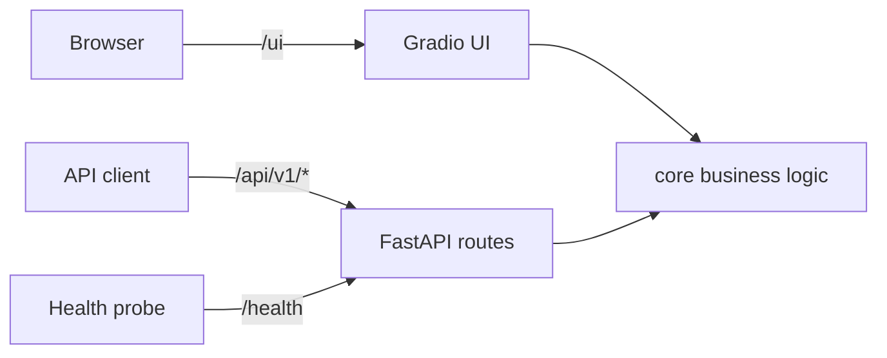

# yapp — Personal Finance Toolkit

A personal finance web app (Loan EMI, SIP planner, Budget analyzer) used as a hands-on playground for **CI/CD, Docker, Kubernetes, Cloud, MLOps and Agentic AI**. The project grows phase by phase — see [notes/PROGRESS.md](notes/PROGRESS.md).

## Architecture



One uvicorn process serves the REST API (FastAPI) and the web UI (Gradio, mounted at `/ui`).

| Path | Purpose |
|------|---------|
| `/ui` | Web UI |
| `/docs` | Interactive API docs (Swagger) |
| `/health` | Liveness check |
| `POST /api/v1/emi` | Loan EMI |
| `POST /api/v1/sip` | SIP projection |
| `POST /api/v1/budget/analyze` | Budget breakdown |

## Configuration

| Env var | Default | Allowed |
|---------|---------|---------|
| `APP_ENV` | `dev` | `dev`, `staging`, `prod` |
| `LOG_LEVEL` | `INFO` | `DEBUG`, `INFO`, `WARNING`, `ERROR`, `CRITICAL` |
| `CURRENCY` | `INR` | any label |

## Local development (Windows PowerShell)

```powershell
python -m venv .venv
.\.venv\Scripts\Activate.ps1
pip install -r requirements.txt
uvicorn app.main:app --reload --port 8000
```
Open http://127.0.0.1:8000/ui — try the Budget tab with [samples/expenses_sample.csv](samples/expenses_sample.csv).

## Roadmap
Docker → CI/CD (GitHub Actions + Docker Hub) → Compose & DB → Kubernetes → Cloud & Terraform → Observability → MLOps → Agentic AI.
