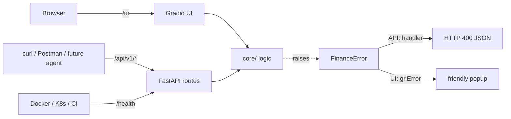

# App Architecture — FastAPI + Gradio, modular design

## What we built
**yapp — Personal Finance Toolkit**: Loan EMI calculator, SIP planner, Budget analyzer (CSV upload).
One Python process (uvicorn) serves both a REST API (FastAPI) and a web UI (Gradio).

```
app/
  __init__.py        version + disables Gradio telemetry
  config.py          Settings from env vars (APP_ENV, LOG_LEVEL, CURRENCY), validated at startup
  logging_setup.py   one stdout log handler, consistent format
  main.py            create_app(): FastAPI + routes + error handler + Gradio mounted at /ui
  core/              PURE business logic - no FastAPI/Gradio imports
    exceptions.py    FinanceError -> InvalidInputError
    emi.py           calculate_emi()
    sip.py           project_sip()  (month-by-month loop)
    budget.py        parse_expenses_csv(), analyze_budget()
  api/
    schemas.py       Pydantic request bodies (API contract)
    routes.py        /health, /api/v1/emi, /api/v1/sip, /api/v1/budget/analyze
  ui/
    gradio_ui.py     3 tabs, each calls core logic directly
```



## Key concepts

### Layered / modular architecture (separation of concerns)
- **core** = what the app does; **api/ui** = how users reach it.
- Core has zero framework imports → unit-testable in milliseconds, reusable as agent tools (Phase 7) or in another service (Phase 2).
- Rule of thumb: dependencies point inward (ui/api → core, never core → ui/api).

### FastAPI & ASGI
- **ASGI** (Asynchronous Server Gateway Interface) = the contract between a Python web app and a web server.
- **uvicorn** = the ASGI *server* (handles sockets/HTTP). **FastAPI** = the *framework* (routing, validation, docs).
- `uvicorn app.main:app` → "import module `app.main`, use the object named `app`".
- Auto docs: `/docs` (Swagger UI) and `/openapi.json` (OpenAPI spec) generated from type hints.
- **Pydantic** validates request bodies → wrong *types* get **422 Unprocessable Entity** automatically.
- Our `FinanceError` handler turns *business rule* violations into **400 Bad Request**.

### Why Gradio over Streamlit (decision record)
| | Gradio | Streamlit |
|---|---|---|
| Execution model | Event-driven: input → function → output | Re-runs the whole script on every interaction |
| Built on | FastAPI/Starlette → can **mount inside our FastAPI app** | Own Tornado server, separate process |
| AI/ML fit | Standard for ML demos (Hugging Face Spaces), `ChatInterface` for agents | Great for data dashboards |
| Our need | One container serving API + UI; future MLOps/agents | — |

Decision: **Gradio mounted at `/ui`** → one process, one image, one port (8000).

### 12-Factor config
- Config lives in environment variables, not code → same image runs in dev/staging/prod.
- `config.py` validates at startup = **fail fast** (crash immediately on bad config, not hours later).
- `.env.example` documents the variables; real `.env` is gitignored.

### Logging
- `logging` > `print`: levels, timestamps, module names, can be filtered/shipped.
- Log to **stdout** → containers/K8s collect stdout (`docker logs`, `kubectl logs`).
- `logger.info("x=%s", x)` (lazy formatting) instead of f-strings in log calls.

### Error handling
- **Expected errors** (bad user input) → custom exception → friendly message, logged as WARNING.
- **Unexpected errors** (bugs) → let them surface (500), don't swallow with bare `except:`.
- Validate at **boundaries** (API request, file upload) — the places untrusted data enters.

### Health checks
- `/health` = **liveness**: "is the process up and responding?"
- Later (K8s): **readiness** = "can it serve traffic?" (e.g. DB connected).

### Security touches
- Upload size limit (`max_file_size="1mb"`), row limit (`MAX_ROWS=5000`) → prevents memory-exhaustion DoS.
- Telemetry disabled (`GRADIO_ANALYTICS_ENABLED=False`) → no unexpected outbound calls.
- Pinned dependency versions → reproducible builds, no surprise upgrades.

## The finance math (just enough)
- **EMI**: fixed monthly payment that repays loan + interest. `r` = monthly rate = yearly% / 12 / 100, `n` = months.
  $$EMI = P \cdot \frac{r(1+r)^n}{(1+r)^n - 1}$$
  Edge case: `r = 0` → formula divides by zero → use `P / n`.
- **SIP**: each month `balance = (balance + monthly) × (1 + r)`. That loop *is* the compounding.

## Interview questions
1. Difference between ASGI and WSGI? (async vs sync; uvicorn vs gunicorn-sync)
2. 400 vs 422 vs 500? (business rule / schema validation / server bug)
3. Why keep business logic out of route handlers?
4. Why log to stdout in containers?
5. What is a liveness vs readiness probe?
6. Why pin dependency versions?
