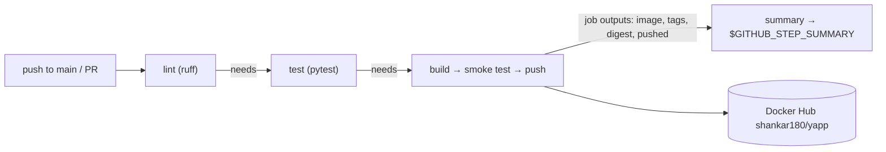

# CI with GitHub Actions — `ci.yml`

## In plain words
A workflow is an instruction sheet GitHub's computer follows by itself on every push/PR. Ours: lint → test → build + smoke-test + push → summary.

## Anatomy
| Key | Meaning |
|---|---|
| `on:` | Trigger (event): `push`, `pull_request`, later `workflow_dispatch`, `schedule` |
| `paths-ignore` | Skip runs when only docs/notes changed |
| `permissions: contents: read` | `GITHUB_TOKEN` read-only (least privilege) |
| `concurrency` | One run per ref; cancel superseded **PR** runs only (never a main run mid-push) |
| `jobs.<id>.runs-on` | Runner (`ubuntu-latest` = fresh GitHub-hosted VM, destroyed after) |
| `needs:` | Order + skip downstream on failure |
| `timeout-minutes` | Default is 6 h — always set |
| `uses:` / `run:` | Ready-made action / shell command |
| `id:` + `steps.<id>.outputs.x` | Read a step's output |
| `jobs.<id>.outputs` → `needs.<id>.outputs.x` | Pass values between jobs (separate machines) |
| `${{ vars.X }}` / `${{ secrets.X }}` | Variable (plain config) / Secret (write-only, masked `***`, not given to fork PRs) |
| `$GITHUB_STEP_SUMMARY` | File; Markdown appended to it shows on the run page |
| `::error::msg` | Workflow command → red annotation |

## Our build job
- `docker/metadata-action` decides tags: push to main → `sha-<7>` + `main`; PR → `pr-N` (not pushed).
- Build with `load: true` → **smoke test** (run container, poll `/health`) → login → push (from GHA cache, seconds).
- Login/push only `if: env.PUSH == 'true'` (push events). PRs build + test the box but never push.
- `cache-to/from: type=gha` keeps the 361 MB dependency layer between runs.

## Tags vs digest
| | Tag | Digest |
|---|---|---|
| Analogy | Sticky note (movable name) | Fingerprint computed from contents |
| Example | `main`, `sha-547f532`, `1.0.0`, `latest` | `sha256:2ed47cd7b8dc…` |
| Changes? | Can be moved to another image | Never; new content = new digest |
| Use | Humans, discovery | Deployments, audits (`image@sha256:…`) |
First push (2026-10-23): `sha-547f532` and `main` → same digest `sha256:2ed47cd7b8dc…`, 152 MB.

## Secrets & variables in this repo
| Kind | Name | Value |
|---|---|---|
| Secret | `DOCKERHUB_TOKEN` | Docker Hub personal access token, Read & Write, expiring |
| Variable | `DOCKERHUB_USERNAME` | `shankar180` |
| Variable | `IMAGE_NAME` | `yapp` |

## Gotchas
- Quote versions in YAML: `"3.12"` (unquoted `3.10` → `3.1`).
- Each job is a new machine → `actions/checkout` first; share data via outputs/artifacts only.
- `paths-ignore` + required status checks → docs-only PRs wait forever (fix when we add branch protection).
- Token with only Read → push fails at login/push step.

## Interview questions
1. Job vs step vs action? How do jobs share data?
2. Secret vs variable? Why don't fork PRs get secrets?
3. Why smoke-test the image before pushing?
4. Why deploy by digest rather than tag?
5. What does `permissions:` do and why set it?
6. How do you avoid wasting CI minutes on docs-only changes?
