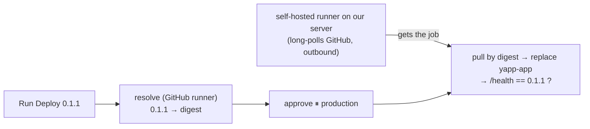

# Deploy — self-hosted runner, deploy.yml, rollback, localhost

## In plain words
The box is on the shelf (Docker Hub). **Deploy = take one exact box and run it on a server.** GitHub's runner can't reach our private server, so a **worker inside** (self-hosted runner) asks GitHub for jobs **outbound** and runs them here.



## Release vs deploy
| | Release | Deploy |
|---|---|---|
| Question | Which box is official? | Which official box runs on this server? |
| How often | Once per version | Many times (redeploy, other servers, **rollback**) |
| Runs on | GitHub runner | Our server's runner |

## Our runner
- Folder `~/shankar/yapp-runner` (outside the repo). Downloaded v2.338.2, **sha256 checksum verified**.
- `./config.sh --url https://github.com/Shankarr-18/yapp --token … --name yapp-runner-bglr --labels yapp-deploy --work _work --unattended` (repo-level runner; token one-time, ~1 h).
- Identity afterwards: `.runner`, `.credentials`, `.credentials_rsaparams` (private key, 600).
- Runs in tmux: `tmux new -s yapp-runner` → `./run.sh` → Ctrl+b d. Check: `tmux capture-pane -pt yapp-runner | tail -3` → "Listening for Jobs".
- Risk on a shared server: runs as `jarvis` (docker group ≈ root). Locks: fork-PR approval, custom label only used by `deploy.yml`, `environment: production` approval, only touches `yapp-app`. Ideal (needs sudo): dedicated user or VM, ephemeral runners.

## deploy.yml design
| Choice | Why |
|---|---|
| `resolve` on `ubuntu-24.04`, `deploy` on `[self-hosted, yapp-deploy]` | Run as little as possible on our server; only the local part runs here |
| Deploy by **digest** | Exactly the box we looked up, even if a tag moved |
| No `actions/checkout` | The server needs the box, not our source |
| `docker rm -f yapp-app` | Only our container, exact name |
| `--restart unless-stopped` | Comes back after reboot/daemon restart |
| `-p 127.0.0.1:8500:8000` | Only this server can connect; view via tunnel |
| `-e APP_ENV=prod` | Same box, prod config at run time |
| `/health` version check | Proves the new version is the one answering |
| `concurrency: deploy-production` | Never two deploys at once |

## Break-glass (manual) deploy and rollback — the runbook
```bash
DIGEST=$(curl -fsS https://hub.docker.com/v2/repositories/shankar180/yapp/tags/0.1.1 | python3 -c "import json,sys; print(json.load(sys.stdin)['digest'])")
IMAGE="docker.io/shankar180/yapp@$DIGEST"
deploy() { docker rm -f yapp-app >/dev/null 2>&1; docker run -d --name yapp-app --restart unless-stopped -p 127.0.0.1:8500:8000 -e APP_ENV=prod "$1" >/dev/null && for i in $(seq 1 30); do curl -fsS http://127.0.0.1:8500/health && break; sleep 2; done; echo; }
deploy "$IMAGE"            # rollback = deploy an older version's digest
```
Measured 2026-11-09: rollback 0.1.1 → 0.1.0 in **4.8 s**. The `Connection reset` lines = seconds of downtime between `rm` and the app starting → zero-downtime needs blue-green / rolling (Kubernetes, Phase 3).

## localhost and tunnels
`localhost` / `127.0.0.1` = **"the machine I'm on right now"** (like "my house"). Laptop, server and every container each have their own.
- Browser `localhost:8500` (laptop) → **VS Code SSH tunnel** → server `127.0.0.1:8500` → Docker → `yapp-app:8000`.
- Command-line equivalent on the laptop: `ssh -L 8500:127.0.0.1:8500 jarvis@10.20.40.161`.
- A friend's `localhost:8500` hits his own laptop — no tunnel, no app.
- Container logs: `127.0.0.1` = HEALTHCHECK inside; `172.17.0.1` = traffic arriving through Docker from outside (our clicks).

## Interview questions
1. How do you deploy from CI to a server in a private network?
2. Why deploy by digest? How do you roll back?
3. What are the risks of a self-hosted runner and how do you limit them?
4. Your deploy has a few seconds of downtime — how would you remove it?
5. What does `localhost` mean inside a container vs on the host?
