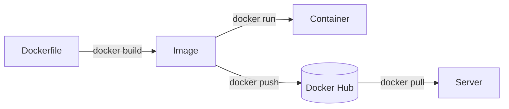

# Docker — Dockerfile, image, container

## Why
Running the app by hand = install Python, venv, pip install exact versions, copy code, start uvicorn — on every machine, and something always differs ("works on my machine"). Docker does those steps **once** into a sealed **image**; the same image (same digest) is tested, pushed and deployed everywhere.

| Word | Analogy | yapp |
|---|---|---|
| Dockerfile | Recipe | [Dockerfile](../../Dockerfile) |
| Image | Cooked meal, sealed box (immutable) | `yapp:dev` locally, `shankar180/yapp:<tag>` on Docker Hub |
| Container | A plate served from the box (running process); many per image | `yapp-dev` (local test), `yapp-app` (deploy, Lesson 5) |

## Our Dockerfile in plain words
| Line | Meaning |
|---|---|
| `FROM python:3.12-slim-trixie AS builder` | Start from small Debian 13 + Python 3.12; stage named builder ("messy kitchen") |
| `RUN python -m venv /opt/venv` / `pip install -r requirements.txt` | Install deps into a venv |
| `FROM ... AS runtime` | Fresh clean stage ("lunchbox") |
| `COPY --from=builder /opt/venv /opt/venv` | Take only the finished venv |
| `COPY app/ ./app/` | Our code (root-owned → app can't modify itself) |
| `USER app` (uid 10001) | Not root |
| `EXPOSE 8000` | Documentation only |
| `HEALTHCHECK ... /health` | Docker marks the container healthy/unhealthy |
| `CMD ["uvicorn", ..., "--host", "0.0.0.0", "--port", "8000"]` | Exec form → PID 1 gets SIGTERM; 0.0.0.0 so port mapping works |

## Best practices applied
- `.dockerignore` (small context, no `.env`/`.git` leaks) · deps layer before code layer (cache) · slim base pinned to Python minor + OS · multi-stage · non-root · healthcheck · exec-form CMD · stdout logging (`PYTHONUNBUFFERED=1`) · **config at runtime** (`-e APP_ENV=prod`), not baked in.
- Later: pin base by digest + Dependabot/Renovate; OCI labels via CI; vulnerability scan (cron workflow).

## Base image choice
`python:3.12` full (~1 GB, compilers) · **`-slim`** (glibc, wheels just work) ✅ · `-alpine` (musl → wheels often compile from source; avoid for pandas/numpy) · distroless (no shell).

## What we measured (2026-10-23)
- 152 MB compressed (content size), 647 MB on disk. Venv layer 361 MB, our code 74 kB → code changes re-push only a tiny layer.
- 3 direct deps → ~50 installed packages (transitive).
- `docker ps`: `Up 12 seconds (healthy)`, `127.0.0.1:8500->8000/tcp`; `id` → `uid=10001(app)`; uvicorn = PID 1.

## Common mistakes
`COPY . .` without `.dockerignore` (ships `.env`, `.git`) · copying code before installing deps (cache busted every build) · app binds `127.0.0.1` in the container (port mapping fails) · shell-form CMD (10 s kill on stop) · running as root · `:latest` base image (unreproducible) · secrets in `ENV`/`ARG` (visible in `docker history`).

## Interview questions
1. Image vs container? Layer? Why does instruction order matter?
2. What does `EXPOSE` do vs `-p`?
3. Why multi-stage? Why non-root?
4. Why must the app listen on 0.0.0.0 inside a container?
5. Exec form vs shell form of `CMD` — what breaks?
6. Why avoid alpine for Python data stacks?
7. How would you keep secrets out of an image?
