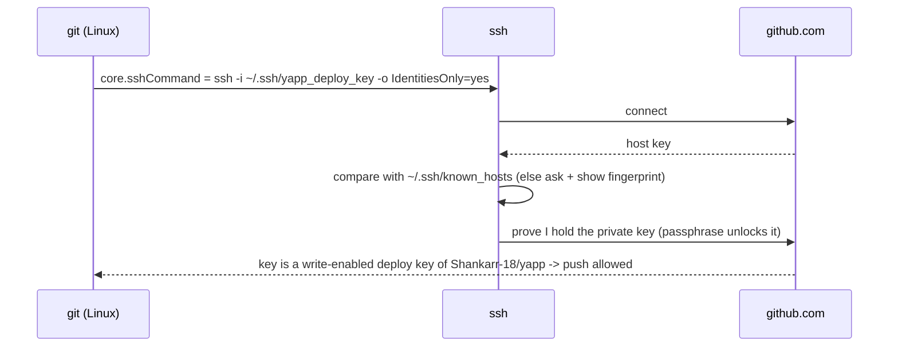

# Git — Identity, Authentication, Config

## What & why
Git is a distributed version control system: every clone has the full history. GitHub is a *hosting service* for Git repos plus collaboration (PRs, Actions, Issues).

## Identity vs Authentication
| | Identity | Authentication |
|---|---|---|
| What | `user.name`/`user.email` stamped in each commit | Proof you're allowed to push |
| Verified? | No — anyone can type any email | Yes |
| Affects | Commit attribution, contribution graph | Whether push succeeds |

- GitHub links a commit to your account if the commit email is a **verified email** on that account.
- Commit **signing** (GPG/SSH) is how you prove identity → "Verified" badge.

## Config levels
`system` (all users) → `global` (your OS user, `~/.gitconfig`) → `local` (this repo, `.git/config`). Most specific wins.
In this repo: global = work email, local = personal email → work repos unaffected.

## Authentication options
| Method | How | Notes |
|---|---|---|
| GCM (HTTPS) | Browser OAuth login, stored in OS credential store | Easiest on Windows; default with Git for Windows |
| PAT (HTTPS) | Token used as password | Use fine-grained, least privilege, expiry. Never paste/commit it |
| SSH key | Public key on GitHub, private key local | Common on Linux/Mac; supports multiple accounts via `~/.ssh/config` |

## SSH auth in this repo (deploy key)

- **Two directions of trust:** host key = I trust the server; my key = the server trusts me.
- **Deploy key vs personal SSH key:** deploy key works for **one repo** only and isn't tied to a user → if leaked, only yapp is exposed. One deploy key can't be reused on another repo. Personal keys open every repo you can access.
- **Why `core.sshCommand`** instead of `~/.ssh/config`: the config is per-repo (`.git/config`), so the shared `jarvis` account's SSH setup stays untouched.
- **Real world:** deploy keys for servers that `git pull` one repo; CI uses short-lived tokens (`GITHUB_TOKEN`) instead; organisations often use GitHub Apps for machine access.

## Rewriting unpushed history
- Author/email are baked into each commit; changing config only affects **new** commits.
- `git rebase --root --exec "git commit --amend --no-edit --reset-author"` replays every commit and re-stamps it with the current identity → **new hashes**.
- Golden rule: rewrite only what you haven't pushed. Pushed history → `git push --force-with-lease` and every other clone must be fixed.
- Alternatives: `git commit --amend --reset-author` (last commit only), `git filter-repo` (big rewrites), `.mailmap` (display-only fix, no rewrite).

## Common beginner mistakes
- Committing with the wrong (work) email → commits not linked to your profile.
- Pasting tokens into chats, code, or `.env` files that get committed.
- Forgetting `.gitignore` before the first commit → `.venv/`, `.env` pushed.

## Interview questions
1. Difference between `git fetch` and `git pull`? (pull = fetch + merge/rebase)
2. Can someone commit as you? How to prevent? (yes; commit signing + branch protection requiring signed commits)
3. What's the difference between global and local config?
4. What does `git push -u` do? (sets the upstream tracking branch)
5. Deploy key vs personal SSH key vs PAT? (repo-scoped key / user-wide key / user token with scopes)
6. What does `known_hosts` protect against? (MITM — talking to a fake server)
7. Why is rewriting pushed history dangerous? (new hashes; collaborators' clones diverge; needs force-push)
