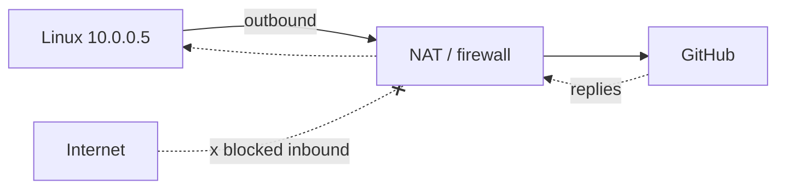

# Networking — Private IPs, NAT, Outbound vs Inbound

## Core idea: who starts the connection?
| | Outbound | Inbound |
|---|---|---|
| Initiator | Your machine | Someone else |
| Examples | `git push`, `docker pull`, `pip install`, browsing | Webhook to your server, SSH into your server |
| From private IP | ✅ via NAT | ❌ not reachable from internet directly |

## Private IP & NAT
- Private ranges (RFC 1918): `10.0.0.0/8`, `172.16.0.0/12`, `192.168.0.0/16` — only meaningful inside a network.
- **NAT** rewrites private source IP → public IP on the way out and remembers the mapping.
- **Stateful firewall**: allows *replies* to connections you started; blocks unsolicited inbound.



## In our project
- Linux machine (private IP) → `git push` / `docker pull` → outbound → works.
- Windows VM browser → github.com → outbound → works.
- GitHub-hosted runners run in GitHub's cloud → never need to reach our machines.
- GitHub is the shared hub; the two machines never talk directly.

## When inbound matters
| Need | Solution |
|---|---|
| CI deploys to a private server | **Self-hosted runner** on that server — polls GitHub over outbound HTTPS, no inbound ports |
| Webhooks to a private app | Tunnels (ngrok, Cloudflare Tunnel) or public load balancer |
| See a remote app from laptop | **SSH port forwarding** (VS Code does it automatically) / `kubectl port-forward` later |

## Checks
```bash
curl -sI https://github.com | head -1
ssh -T git@github.com
docker pull hello-world
```

## Interview questions
1. How can a machine with a private IP reach the internet? (NAT)
2. How do self-hosted runners work behind a firewall? (outbound long-polling, no inbound ports)
3. What does "stateful firewall" mean?
4. How would you access a web app running on a private server from your laptop? (SSH tunnel / port-forward / bastion)
