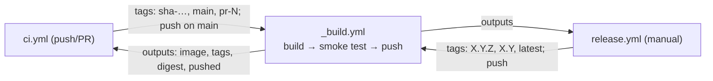
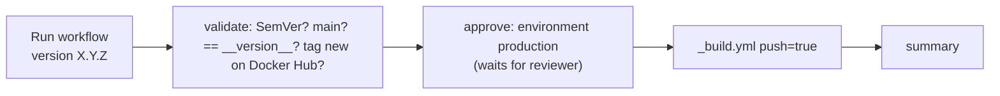

# Release (manual workflow) + reusable workflow

## Reusable workflow = a function
| Python | GitHub Actions (`_build.yml`) |
|---|---|
| `def build_and_push(tags, push=False)` | `on: workflow_call:` with `inputs: tags, push` |
| sensitive argument | `secrets: DOCKERHUB_TOKEN` (caller passes it explicitly) |
| `return digest` | workflow `outputs:` → `value: ${{ jobs.build.outputs.digest }}` |
| call it | `jobs.<id>.uses: ./.github/workflows/_build.yml` + `with:` + `secrets:` |

Only reusable workflows have **workflow-level outputs** (normal workflows only have job/step outputs).

## release.yml flow

## Key ideas
- **SemVer** `MAJOR.MINOR.PATCH`. Tags pushed: `X.Y.Z` (never moves), `X.Y` (newest patch), `latest` (newest release).
- **Single source of truth:** `__version__` in `app/__init__.py`; release refuses mismatches. To release: bump in code → commit → Run workflow.
- **Immutable versions:** validate fails if the tag already exists on Docker Hub.
- **Environment `production`:** required reviewer Shankarr-18 (self-review allowed — solo), main only. Jobs with `environment:` pause; a job that `uses:` a reusable workflow can't have `environment:` → separate `approve` gate job.
- **Script injection:** never `run: echo ${{ inputs.version }}`; use `env: VERSION: ${{ inputs.version }}` then `$VERSION`.
- **Build once, promote (todo):** our release rebuilds → digest differs from CI's image of the same commit. Better: re-tag the tested `sha-<commit>` image (`docker buildx imagetools create`).

## Results (2026-10-23)
- Release run 39996665909 → `0.1.0`, `0.1`, `latest` = `sha256:0bb60bfd…` (CI `sha-f3cd704` = `sha256:eb5c2045…`).
- Run with `0.1.1` → validate failed: "Input 0.1.1 != __version__ 0.1.0".

## Interview questions
1. What is a reusable workflow and how does it differ from a composite action?
2. How do you add a human approval step before production?
3. Why should release tags be immutable? What do `latest` and `1.2` mean?
4. What is script injection in GitHub Actions and how do you prevent it?
5. "Build once, deploy many" — why?
