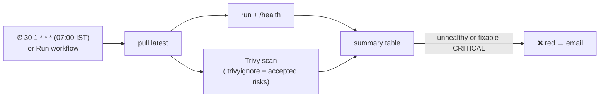

# Cron workflow + vulnerability scanning (security)

## In plain words
Every morning GitHub's computer wakes up by itself (no push, no click), pulls the **published** image `shankar180/yapp:latest`, starts it, checks `/health`, and scans it for **known security holes**. If something is wrong, the run goes red and GitHub emails you. Free monitoring.



## Why scan an image that didn't change?
New **CVEs** (publicly listed vulnerabilities) are found every day in libraries we already ship (Debian, Python, pandas, pillow…). Yesterday's safe image can be vulnerable today.

## Cron
`min hour day-of-month month day-of-week` — **always UTC** (IST = UTC+5:30). Tool: crontab.guru.
| Expression | Meaning |
|---|---|
| `30 1 * * *` | Daily 01:30 UTC = 07:00 IST (ours) |
| `*/15 * * * *` | Every 15 min |
| `0 9 * * 1` | Mondays 09:00 UTC |
GitHub caveats: may start late (avoid minute 0), runs from the default branch, disabled after 60 days of repo inactivity (public repos), failure emails the last editor of the cron line.

## Our policy
- Report CRITICAL + HIGH with a fix available (`ignore-unfixed: true`); **fail only on fixable CRITICAL**.
- `if: always() && steps.pull.outcome == 'success'` → scan + summary still run if health fails.
- Step outputs via `$GITHUB_OUTPUT` (digest, version) → summary.
- Trivy action pinned by commit SHA: `aquasecurity/trivy-action@ed142fd0673e97e23eac54620cfb913e5ce36c25 # v0.36.0`.

## First real finding (2026-10-23) — vulnerability triage
| Question | Answer |
|---|---|
| What? | 27 CVEs (4 CRITICAL, 23 HIGH), all in `pillow 12.3.0`, fixed in 13.0.0 |
| Who brings it in? | Transitive: `gradio` → `pillow` |
| Can we upgrade? | No — gradio 6.30.0 (latest) requires `pillow<13` |
| Exploitable in yapp? | Likely low: needs a malicious **image** to be processed; yapp only accepts CSV |
| Decision | Accept with expiry: `.trivyignore`, `exp:2026-11-23`, reason in the header |
| Revisit | When gradio allows pillow ≥ 13 → bump, rebuild, release `0.1.1`, delete entries |

Options compared: **wait** (always red → alert fatigue) · **force pillow 13** (breaks gradio's contract) · **accept with expiry** ✅ · replace gradio (out of scope).

Reproduce locally (shared server: no Docker socket, remove the image afterwards):
```bash
docker run --rm aquasec/trivy:0.76.1 image --image-src remote --severity CRITICAL,HIGH --ignore-unfixed docker.io/shankar180/yapp:latest
docker run --rm -v "$PWD/.trivyignore:/work/.trivyignore:ro" aquasec/trivy:0.76.1 image --image-src remote --ignorefile /work/.trivyignore ...
docker rmi aquasec/trivy:0.76.1
```

## Supply-chain hygiene used in this repo
- Pin Python deps (`==`), base image (`3.12-slim-trixie`), runner (`ubuntu-24.04`), GitHub/Docker actions by major tag, **third-party actions by commit SHA**.
- Least privilege: `permissions: contents: read`, explicit secrets to reusable workflows, Docker Hub token Read & Write only, expiring.
- Later: Dependabot/Renovate to bump pins automatically.

## Interview questions
1. Why scan images on a schedule and not only at build time?
2. A scanner reports a CRITICAL CVE you can't fix yet. What do you do?
3. What is alert fatigue and how do you avoid it?
4. Why pin a third-party GitHub Action to a commit SHA?
5. Cron in GitHub Actions — which timezone, and what are the caveats?
