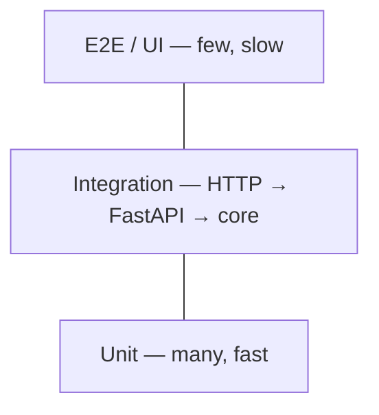

# Testing — pytest, unit vs integration

## Why (CI/CD angle)
CI runs `pytest` on every push; a red test blocks the image from being built/pushed. No tests → CI only proves the code installs.

## Test pyramid

| | Unit | Integration |
|---|---|---|
| yapp | `tests/unit` → `app/core/*`, `app/config.py` | `tests/integration` → `/health`, `/api/v1/*`, `/ui` |
| Speed | ~0.35s wall | ~2.7s wall (Gradio import) |
| Catches | Logic bugs, boundaries | Wiring, status codes (200/400/405/422), JSON contract |

## Layout & config
```
pyproject.toml          # [tool.pytest.ini_options] pythonpath, testpaths, addopts
requirements-dev.txt    # -r requirements.txt + pytest, pytest-cov, httpx (never in prod image)
tests/unit/test_*.py
tests/integration/conftest.py   # session-scoped TestClient fixture
tests/integration/test_api.py
```

## Techniques used
- **AAA** (Arrange, Act, Assert); one behaviour per test.
- **Oracle** values from outside the code (textbook EMI 8884.88, annuity-due formula for SIP).
- **Boundaries** (0, 100, 50, MAX_ROWS) — proved by deliberately breaking `<=`.
- `pytest.approx` for floats, `pytest.raises(..., match=...)` for errors, `parametrize` with `ids=`.
- Fixtures: function scope for mutable data, session scope only for stateless expensive things.
- `monkeypatch` for env vars; call uncached `load_settings()` (beware `@lru_cache`).
- Don't assert on the developer's environment (`env in VALID_ENVS`, not `== "dev"`).

## Coverage
Tool for finding gaps, not a target. Found two real gaps (JSON budget validation, config fail-fast). Remaining debt: Gradio callbacks.

## Common mistakes
Happy-path only · `==` on floats · re-implementing the formula in the test · shared mutable state / leaking env vars · `sys.path` hacks · tests that never failed.

## Interview questions
1. Unit vs integration test? Give an example from your project.
2. What does a fixture's scope control, and when is `session` scope dangerous?
3. Why is 100% coverage not proof of correctness?
4. How do you test code that reads environment variables?
5. How does FastAPI's `TestClient` work without starting a server?
6. A test passes alone but fails in the full run — what do you check?
